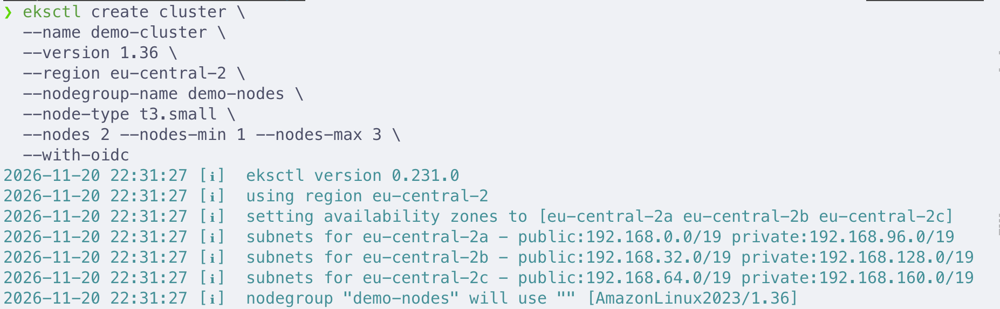
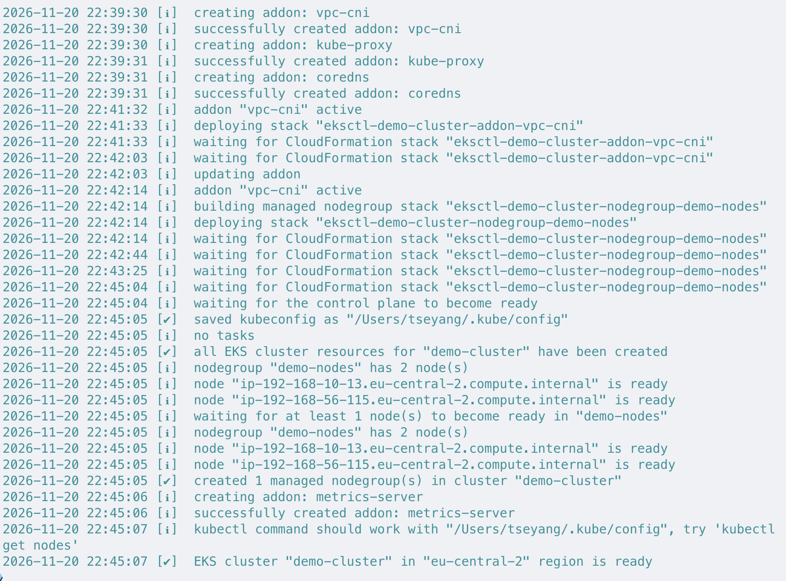
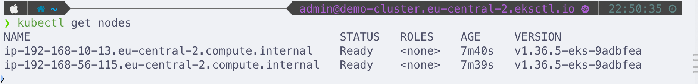
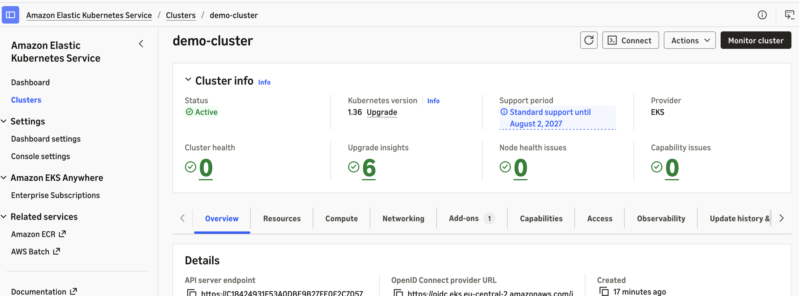
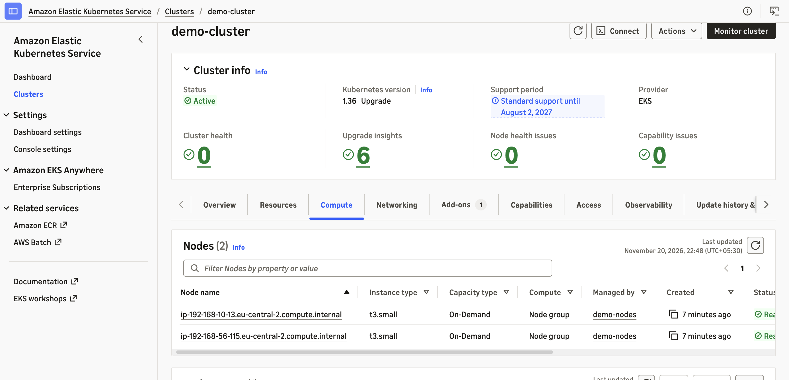
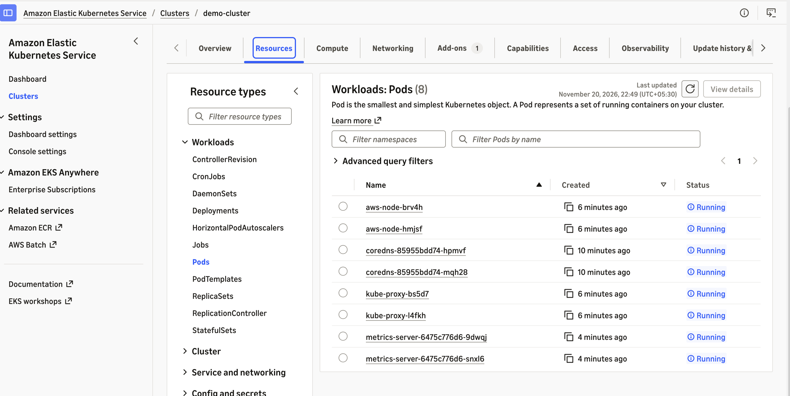

# EKS Cluster with eksctl

## Description

In this project we create an Amazon EKS cluster and managed node group with a single `eksctl` command, instead of repeating the manual console setup (cluster, IAM roles, VPC, node group) from our previous project.

`eksctl` is a CLI tool that automates these tasks through CloudFormation, and we can also use it to manage the cluster after it is created.

## Technologies Used

- Kubernetes
- AWS EKS
- eksctl
- AWS CLI
- kubectl
- Linux / macOS terminal

## Prerequisites

- An AWS account with no existing cluster from the previous project.
- [AWS CLI](https://docs.aws.amazon.com/cli/latest/userguide/getting-started-install.html) and [kubectl](https://kubernetes.io/docs/tasks/tools/) installed.
- An AWS user with enough permissions to create EKS, EC2, VPC, IAM and CloudFormation resources. We use the admin user we created in AWS.

## Steps

### 1. Install eksctl

For macOS:

```sh
brew tap weaveworks/tap
brew install weaveworks/tap/eksctl
```

### 2. Configure AWS credentials

`eksctl` needs our AWS credentials to create the resources. We check which credentials, config file and region are active:

```sh
aws configure list
```

### 3. Create the cluster

We run `eksctl create cluster` and override the defaults we care about:

```sh
eksctl create cluster \
  --name demo-cluster \
  --version 1.36 \
  --region eu-central-2 \
  --nodegroup-name demo-nodes \
  --node-type t3.small \
  --nodes 2 --nodes-min 1 --nodes-max 3 \
  --with-oidc
```

| Option | Meaning |
| --- | --- |
| `--name` | Name of the EKS cluster |
| `--version` | Kubernetes version |
| `--region` | AWS region to create everything in |
| `--nodegroup-name` | Name of the managed node group |
| `--node-type` | EC2 instance type of the worker nodes |
| `--nodes`, `--nodes-min`, `--nodes-max` | Desired, minimum and maximum number of nodes |
| `--with-oidc` | Creates an OIDC provider for the cluster (needed for IAM roles for service accounts) |



`eksctl` picks three availability zones and creates a dedicated VPC, `eksctl-demo-cluster/VPC`, with a public and a private subnet in each one.

The command takes around 15 minutes. It deploys one CloudFormation stack for the cluster and one for the node group, creates the add-ons, and saves a kubeconfig locally so `kubectl` can talk to the new cluster.



In the background `eksctl` also adds new IAM roles and policies in our account, such as the `AWSServiceRoleForAmazonEKS` service-linked role.

### 4. Verify the nodes with kubectl

```sh
kubectl get nodes
```

We see the 2 desired nodes with their private IPs, region and Kubernetes version.



### 5. Check the resources in AWS

**EKS cluster**: in the AWS console, we open *Amazon EKS > Clusters > demo-cluster*. The status is **Active**.



**Nodes**: under the *Compute* tab, there are 2 `t3.small` On-Demand instances managed by the `demo-nodes` node group.



**Workloads**: under *Resources > Pods* we see our cluster running these system components:

- `aws-node`: enables pod networking and communication with our AWS account
- `coredns` and `kube-proxy`: core Kubernetes components needed to run scheduled pods and configure services
- `metrics-server`: collects resource metrics from the nodes



### 6. Clean up

To avoid extra AWS charges, delete the cluster once it's no longer needed:

```sh
eksctl delete cluster --name demo-cluster --region eu-central-2
```